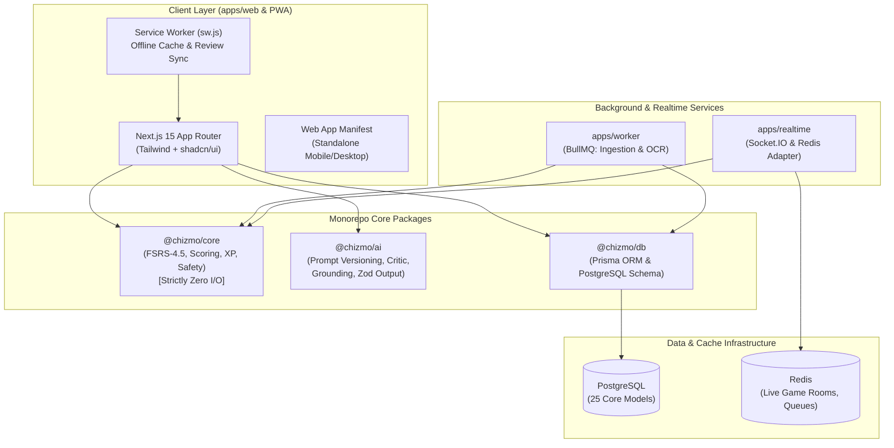

# Chizmo ⚡🦉
> **Make studying feel like a game you actually want to play.**

[](https://github.com/Senseiweewoo/chizmo/actions/workflows/ci.yml)
[](https://nodejs.org/)
[](https://nextjs.org/)
[](https://www.typescriptlang.org/)
[](https://tailwindcss.com/)
[](LICENSE)

Chizmo is an AI-powered study platform combining modern spaced repetition (FSRS-4.5) with instant multi-format content ingestion, gamification streaks with ethical guardrails, real-time multiplayer quiz arenas, Socratic AI coaching, and seamless offline PWA study.

---

## 🏗️ System Architecture



---

## ⚡ Core Invariants & Architectural Rules

1. **Card Content vs. Scheduling State Separation**:
   - `Card` represents immutable or author-edited study content.
   - `CardState` represents an individual user's scheduling state (`state`, `stability`, `difficulty`, `due`, `reps`, `lapses`).
   - *Never store scheduling fields directly on `Card`*, ensuring public and shared decks can be studied by thousands of users without data collision.
2. **Append-Only Review Log (`ReviewLog`)**:
   - Every rating produces an immutable log entry (`userId`, `cardId`, `rating`, `prevState`, `elapsedDays`, `scheduledDays`, `responseMs`, `reviewedAt`).
   - Used as ground truth for replaying intervals, FSRS weight calibration, and calculating verifiable streaks.
3. **Pure Core Logic (`packages/core`)**:
   - Strictly zero external I/O, network requests, or system clock calls.
   - Clocks (`now: Date`) and configurations are always injected as function arguments to guarantee 100% deterministic unit testing.

---

## 🎮 16 Development Phases & Feature Directory

| Phase | Feature | Key Routes & Capabilities |
| :--- | :--- | :--- |
| **1** | **Monorepo Scaffold & Design System** | Guest authentication, Prisma schema (25 models), Electric Indigo (`#6366F1`) & Volt Amber (`#F59E0B`) tokens |
| **2** | **Deck Studio & 3D Flashcards** | `/study/[deckId]` — 3D perspective flip cards, keyboard shortcuts (Space / 1-4), FSRS ratings |
| **3** | **Daily Queue & Exam Mode** | `/study/daily` — Cross-deck interleaved queues, 96% retention target surge in final 7 days, leech detection ($\ge 8$ lapses) |
| **4** | **AI Card Generation & Critic Pipeline** | `/create` — Topic & pasted text generation, markdown chunker, LLM critic pass, grounding quote verification |
| **5** | **Content Ingestion Pipeline** | `/create?type=pdf` — Magic bytes validation, SSRF guard, text de-hyphenation, Quizlet/Anki import, YouTube transcript parser |
| **6** | **Multi-Mode Study Suite** | Speed Quiz (`/quiz`), Write-It-Out (`/write`), Tile Match (`/match`), Timed Exam (`/test`), Weak-Spots Drill (`/weak-spots`) |
| **7** | **Gamification & Ethical Guardrails** | `/leaderboard` — Event-driven XP reducer, level curves, automatic streak freezes (max 2), 24h repair window, opt-out toggles |
| **8** | **Socratic AI Tutor & Crisis Safety** | `/study/[deckId]/tutor` — Guided hints, anti-homework-mill protections, 24/7 crisis self-harm detection |
| **9** | **Community Explore Hub** | `/explore` — Search, category tags, card previews, 1-click "Fork & Study", abuse reporting dialog |
| **10** | **Multiplayer Live Quiz ("Chizmo Live")** | `/live`, `/live/host/[roomCode]`, `/live/play/[roomCode]` — 6-character PIN join, Kahoot-style controller, podium celebration |
| **11** | **Learning Analytics & Forgetting Curve** | `/analytics` — FSRS stability telemetry, 7-day review bar chart, dynamic SVG forgetting curve projection |
| **12** | **Pro Paywall & Subscriptions** | `/pricing` — Free vs. Pro tier entitlements, Monthly/Annual switch (save 33%), student discounts |
| **13** | **Programmatic SEO & General Tutor** | `/tutor`, `/prep/[exam]/[subject]` — SSG landing hubs for AP Bio, AP Chem, SAT Vocab, SAT Math, GCSE Physics |
| **14** | **Accessibility & Focus Standards** | WCAG 2.2 AA compliant contrast, high-visibility focus indicators, `@media (prefers-reduced-motion)` overrides |
| **15** | **60-Second Rapid Onboarding** | `/onboarding` — 5-step fast start wizard, zero-barrier guest study session, instant 1-day streak claim modal |
| **16** | **PWA & Offline Study Support** | `manifest.json`, `sw.js` — Service worker caching, offline flashcards, background review sync queue |

---

## 📐 Scientific Spaced Repetition (FSRS-4.5)

Chizmo implements the **FSRS-4.5 (Free Spaced Repetition Scheduler)** standard:

- **Retrievability Decay**:
  $$R(t) = \left(1 + \text{FACTOR} \cdot \frac{t}{S}\right)^{-w_0}$$
- **Stability Updating ($S$)**:
  - On Successful Recall ($r \in \{3, 4\}$):
    $$S' = S \cdot \left(1 + e^{w_8} \cdot (11 - D) \cdot S^{-w_9} \cdot (e^{w_{10} \cdot (1 - R)} - 1)\right)$$
  - On Lapse ($r = 1$):
    $$S' = \min\left(w_{11} \cdot D^{-w_{12}} \cdot \left((S + 1)^{w_{13}} - 1\right) \cdot e^{w_{14} \cdot (1 - R)}, S\right)$$
- **Leech Management**: Automatically flags cards with $\ge 8$ lapses for review or AI rewriting.
- **Timezone & Rollover**: Computes review queues using the user's local timezone with a default 04:00 AM day-rollover.

---

## 🛡️ Gamification Ethics & Safety Guardrails

- **Level Curve**: $\text{xpForLevel}(n) = \text{round}(100 \times n^{1.5})$.
- **No Guilt Patterns**: No shame-based push notifications, countdown timers, or fake urgency.
- **Streak Protection**: Bank up to 2 streak freezes (earned every 7-day milestone) and a 24-hour grace repair window.
- **Quiet Hours**: Notification blackout between 9:00 PM and 8:00 AM local time.
- **Mindful Opt-Out**: Users can disable streaks and leaderboards with a single click.
- **24/7 Crisis Safety Protocol**: AI tutor detects self-harm/crisis cues, immediately halts homework assistance, offers compassionate text, and surfaces free, verified 24/7 hotlines (e.g. 988 Suicide & Crisis Lifeline, Crisis Text Line 741741).

---

## 🚀 Quickstart Guide

### Prerequisites
- Node.js 22.x
- Docker & Docker Compose (for PostgreSQL and Redis)

### Installation
```bash
# Clone the repository
git clone https://github.com/Senseiweewoo/chizmo.git
cd chizmo

# Install dependencies across all workspaces
npm install

# Start local PostgreSQL and Redis
docker compose up -d

# Generate Prisma client and push schema
npm run db:generate
npm run db:push

# Build monorepo packages (@chizmo/core, @chizmo/db, @chizmo/ai)
npm run build:packages

# Run the development server
npm run dev
```

Visit `http://localhost:3000` to launch Chizmo!

---

## 🧪 Testing & Verification

```bash
# Run strict TypeScript typecheck across all workspaces
npm run typecheck

# Run test suites (35/35 passing)
npm run test

# Run production build
npm run build
```

---

## 📄 License
This project is licensed under the MIT License.
